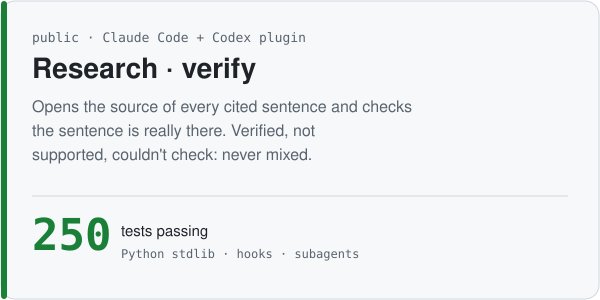

<picture><source media="(prefers-color-scheme: dark)" srcset="assets/hero-dark.svg"></picture>

<samp><a href="https://inpilot.dev">블로그</a> · <a href="mailto:alstmdqls03@gmail.com">메일</a> · <a href="README.md">English</a></samp>

AI 에이전트로 금융 데이터 백엔드를 만들고, 에이전트를 믿을 수 있게 하는 검사도 만듭니다.
**계산은 규칙이 한다. 판단은 모델이 한다. 의심은 사람이 맡는다.**

### 여기부터 보세요

  <a href="https://github.com/inpilot-dev/hacku-2026"><picture><source media="(prefers-color-scheme: dark)" srcset="assets/card-mandate-dark.svg"></picture></a>
  <a href="https://github.com/inpilot-dev/ledger-exceptions"><picture><source media="(prefers-color-scheme: dark)" srcset="assets/card-ledger-exceptions-dark.svg"></picture></a>

  <a href="https://github.com/inpilot-dev/prompt-forge"><picture><source media="(prefers-color-scheme: dark)" srcset="assets/card-prompt-forge-dark.svg"></picture></a>
  <a href="https://github.com/inpilot-dev/reviewPaper"><picture><source media="(prefers-color-scheme: dark)" srcset="assets/card-reviewPaper-dark.svg"></picture></a>

  <a href="https://github.com/inpilot-dev/seungbin-dev"><picture><source media="(prefers-color-scheme: dark)" srcset="assets/card-seungbin-dev-dark.svg"></picture></a>
  <a href="https://github.com/inpilot-dev/Research"><picture><source media="(prefers-color-scheme: dark)" srcset="assets/card-research-dark.svg"></picture></a>

### 에이전트와 일하는 방식

<picture><source media="(prefers-color-scheme: dark)" srcset="assets/flow-dark.svg"></picture>

- **반복되는 일은 긴 프롬프트가 아니라 스킬로 만든다.** prompt-forge는 공개했고, 스킬 9개가 비공개 Claude Code 플러그인에 더 있다.
- **게이트는 코드에 둔다.** 테스트가 실패하면 Stop 훅이 에이전트를 끝내지 못하게 막는다. 무인 실행의 쓰기 범위는 프롬프트 문장이 아니라 `--allowedTools`가 정한다.
- **숫자 계산은 모델에게 시키지 않는다.** 잔액·점수·카드 글자는 코드가 계산하거나 그린다. 모델은 판단하고 설명한다.
- **증명하지 못한 것은 적어 둔다.** Mandate README에는 "Not claimed" 절이 있다. QuantPilot은 후보 전략이 전부 walk-forward·무작위 대조 게이트를 통과하지 못해 접었고, 실제 돈은 넣지 않았다.

### 1인 기업 마케팅, 자동으로

<picture><source media="(prefers-color-scheme: dark)" srcset="assets/engine-dark.svg"></picture>

- **주제 하나가 채널 여섯 개로 나간다.** 매일 다이제스트가 소스를 모으고, Claude가 초안을 쓰고, 채점기가 목소리 규칙 20개와 "숫자가 전부 출처에 있는지"를 검사한다. 발행 버튼은 PR 머지 하나뿐이다. 코드: [seungbin-dev](https://github.com/inpilot-dev/seungbin-dev).
- **지금 가동 중:** [inpilot.dev](https://inpilot.dev) 블로그(글 45편, 토요일마다 새 초안)와 Threads(월·수·금 발행 큐). 매일 다이제스트는 지금까지 32번 모두 성공했다.
- **만들어 두고 아직 켜지 않은 것:** 인스타그램 캐러셀(1080×1350, 글자는 코드가 그린다), 9:16 릴스(Remotion), 긴 영상을 60초 쇼츠로 자르는 컷터(Whisper + 남길 구간을 LLM이 고른다), 주간 뉴스레터(Resend). 켜기 전까지는 모두 드라이런에서 멈춘다.

### 만들 수 있는 것

| 층 | 써 본 것 | 어디서 |
|---|---|---|
| 프런트엔드 | Next.js 16 · React · Vite · Tailwind · shadcn/Radix · MDX · 오프라인 PWA · Three.js | [inpilot.dev](https://inpilot.dev) · [hacku-2026](https://github.com/inpilot-dev/hacku-2026) · overload-log, char-kit *(비공개)* |
| 백엔드 | FastAPI · Java 17 + Spring Boot(헥사고날, ArchUnit) · Node/Bun · 서버리스 함수 | [reviewPaper](https://github.com/inpilot-dev/reviewPaper) · [hacku-2026](https://github.com/inpilot-dev/hacku-2026) · order-ledger *(비공개)* |
| 데이터 | PostgreSQL/Supabase · pgvector · SQLite · Oracle · 이벤트 소싱 · Flyway 마이그레이션 · Kafka · Redis | [ledger-exceptions](https://github.com/inpilot-dev/ledger-exceptions) · order-ledger, NutriCoach *(비공개)* |
| AI | Claude API(인용) · `claude -p` · Ollama · RAG · 평가 게이트 · MCP 서버 · 브라우저 에이전트 · Claude Code 스킬·플러그인·훅 | [Research](https://github.com/inpilot-dev/Research) · [reviewPaper](https://github.com/inpilot-dev/reviewPaper) · [hacku-2026](https://github.com/inpilot-dev/hacku-2026) · [prompt-forge](https://github.com/inpilot-dev/prompt-forge) |
| 자동화 | GitHub Actions · launchd 데몬 · 디스코드/텔레그램 봇 · Playwright 렌더링 · 헤드리스 Chrome PDF | [seungbin-dev](https://github.com/inpilot-dev/seungbin-dev) · brain-secretary, card-news *(비공개)* |
| 영상·그래픽 | Remotion · 생성 SVG · canvas | motion *(비공개)* · [이 README](scripts/build_svgs.py) |
| 인프라 | Docker/Compose · Vercel · Fly.io · GitHub Pages · CI | [reviewPaper](https://github.com/inpilot-dev/reviewPaper)(Fly.io) · [inpilot.dev](https://inpilot.dev)·[sector-weather](https://sector-weather.vercel.app)(Vercel) |
| 테스트 | pytest · JUnit 5 + Testcontainers · vitest · Playwright e2e · Z3 모델 체킹 · 손으로 코드를 망가뜨려 확인한 단정 | [hacku-2026](https://github.com/inpilot-dev/hacku-2026) · [Research](https://github.com/inpilot-dev/Research) · order-ledger *(비공개)* |
| 시장 데이터 | OKX(ccxt) · 한국투자증권 Open API · Alpaca WebSocket · Polymarket | QuantPilot, sector-weather, order-ledger, polymarket-bot *(비공개)* |
| 모바일 | SwiftUI | mofit-ios, iOS 프로토타입 *(비공개)* |

<table><tr><td valign="top" width="58%">

**최근 글** ([RSS](https://inpilot.dev/rss.xml)에서 매일 갱신)

<!-- BLOG-POST-LIST:START -->
- [ipfs 호환을 끊고 QUIC 하나만 남겼다 — iroh 1.0까지의 설계 결정](https://inpilot.dev/posts/iroh-road-to-1-0-cuts)
- [봇 수익 인증 세 건을 숫자만 빼고 다시 읽었다 — Polymarket PnL이 증명하지 못하는 것](https://inpilot.dev/posts/polymarket-bot-pnl-proves-little)
- [&lt;think&gt; 태그가 아니라 effort 레벨이다 — 추론 모델의 계산 제어](https://inpilot.dev/posts/reasoning-effort-not-think-tag)
- [결과는 그대로 나왔는데 과정은 사라졌다 — GPT-6 Astra 러닝 루트 생성](https://inpilot.dev/posts/astra-running-route-compaction)
- [무료지만 최신이 아니다 — syndication 429 실측과 종량제 API v2](https://inpilot.dev/posts/x-crawling-429-pay-per-use)
<!-- BLOG-POST-LIST:END -->

</td><td valign="top" width="42%">

**비공개로 돌리는 것**

- 개인 OS: Claude Code가 운영하는 지식 볼트, 노트를 C1–C3으로 등급, launchd 주간 리뷰
- seungbin-plugin: grill → spec → tickets → build, Stop 훅 테스트 게이트
- brain-secretary: 표준 라이브러리만 쓰는 브리핑 봇, 테스트 29개, 뮤테이션 테스트
- card-news: 주제 한 줄 → 카드 8장, 글자는 코드가 그린다
- polymarket-bot: 자율 개발 루프, 일 하나마다 헤드리스 Claude 세션을 새로 열고 커밋 하나
- sector-weather: 4주 팀 실험, 업종 지수 → 트리맵·LLM 설명·전망 채점 ([아카이브](https://sector-weather.vercel.app))

</td></tr></table>

<picture><source media="(prefers-color-scheme: dark)" srcset="https://raw.githubusercontent.com/inpilot-dev/inpilot-dev/output/snake-dark.svg"></picture>

이 README의 그림은 [`scripts/build_svgs.py`](scripts/build_svgs.py)가 만든다. 숫자는 링크된 각 repo 기준(2026년 10월).
