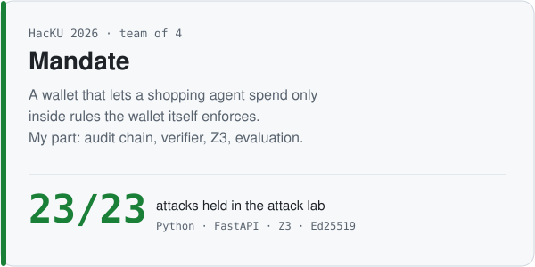
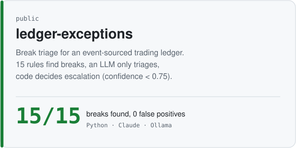
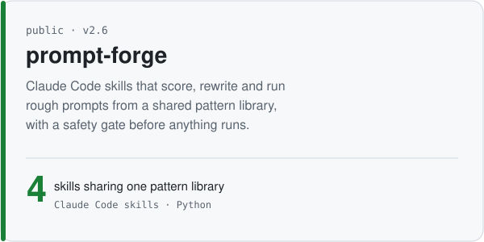
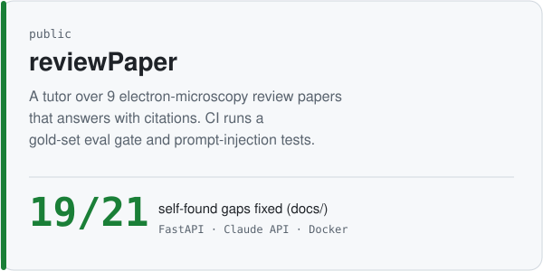
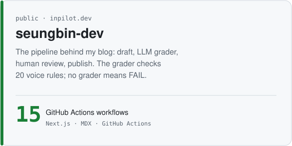
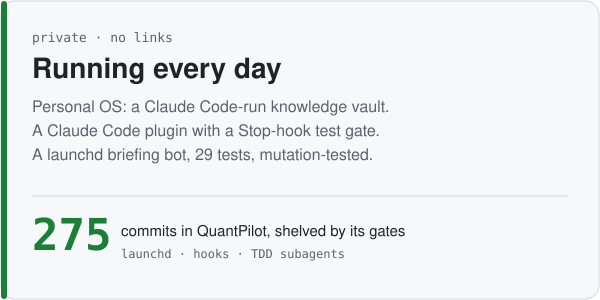

<picture><source media="(prefers-color-scheme: dark)" srcset="assets/hero-dark.svg"></picture>

<samp><a href="https://inpilot.dev">blog</a> · <a href="mailto:alstmdqls03@gmail.com">email</a> · <a href="README.ko.md">한국어</a></samp>

I build backends for financial data with AI agents, and the checks that keep the agents honest.
**Rules do the arithmetic. The model does the judgment. A human owns the doubt.**

### Start here

  <a href="https://github.com/inpilot-dev/hacku-2026"><picture><source media="(prefers-color-scheme: dark)" srcset="assets/card-mandate-dark.svg"></picture></a>
  <a href="https://github.com/inpilot-dev/ledger-exceptions"><picture><source media="(prefers-color-scheme: dark)" srcset="assets/card-ledger-exceptions-dark.svg"></picture></a>

  <a href="https://github.com/inpilot-dev/prompt-forge"><picture><source media="(prefers-color-scheme: dark)" srcset="assets/card-prompt-forge-dark.svg"></picture></a>
  <a href="https://github.com/inpilot-dev/reviewPaper"><picture><source media="(prefers-color-scheme: dark)" srcset="assets/card-reviewPaper-dark.svg"></picture></a>

  <a href="https://github.com/inpilot-dev/seungbin-dev"><picture><source media="(prefers-color-scheme: dark)" srcset="assets/card-seungbin-dev-dark.svg"></picture></a>
  <picture><source media="(prefers-color-scheme: dark)" srcset="assets/card-private-dark.svg"></picture>

### How I work with agents

<picture><source media="(prefers-color-scheme: dark)" srcset="assets/flow-dark.svg"></picture>

- **Repeated work becomes a skill, not a longer prompt.** prompt-forge is public; 9 more skills live in a private Claude Code plugin.
- **Gates live in code.** A Stop hook keeps the agent from finishing while tests fail. Unattended runs get their write scope from `--allowedTools`, not from a sentence in the prompt.
- **Models don't do the math.** Balances, scores and card text are computed or drawn by code; the model judges and explains.
- **I write down what isn't proven.** Mandate's README has a "Not claimed" section. QuantPilot was shelved when every candidate strategy failed its walk-forward and random-control gates, so no real money was traded.

<table><tr><td valign="top" width="58%">

**Latest writing** (Korean · updates daily from [RSS](https://inpilot.dev/rss.xml))

<!-- BLOG-POST-LIST:START -->
- [ipfs 호환을 끊고 QUIC 하나만 남겼다 — iroh 1.0까지의 설계 결정](https://inpilot.dev/posts/iroh-road-to-1-0-cuts)
- [봇 수익 인증 세 건을 숫자만 빼고 다시 읽었다 — Polymarket PnL이 증명하지 못하는 것](https://inpilot.dev/posts/polymarket-bot-pnl-proves-little)
- [`<think>` 태그가 아니라 effort 레벨이다 — 추론 모델의 계산 제어](https://inpilot.dev/posts/reasoning-effort-not-think-tag)
- [결과는 그대로 나왔는데 과정은 사라졌다 — GPT-6 Astra 러닝 루트 생성](https://inpilot.dev/posts/astra-running-route-compaction)
- [무료지만 최신이 아니다 — syndication 429 실측과 종량제 API v2](https://inpilot.dev/posts/x-crawling-429-pay-per-use)
<!-- BLOG-POST-LIST:END -->

</td><td valign="top" width="42%">

**Running privately**

- Personal OS: knowledge vault run by Claude Code, notes graded C1–C3, weekly review on launchd
- seungbin-plugin: grill → spec → tickets → build, Stop-hook test gate
- brain-secretary: stdlib-only briefing bot, 29 tests, mutation-tested
- card-news: topic → 8 cards, text drawn by code

</td></tr></table>

<picture><source media="(prefers-color-scheme: dark)" srcset="https://raw.githubusercontent.com/inpilot-dev/inpilot-dev/output/snake-dark.svg"></picture>

Python · FastAPI · TypeScript · Next.js · Supabase/pgvector · SQLite · Docker · GitHub Actions · Vercel · Claude API · Ollama · Z3 — learning Kotlin · Spring · Kafka. Images in this README are generated by [`scripts/build_svgs.py`](scripts/build_svgs.py).
